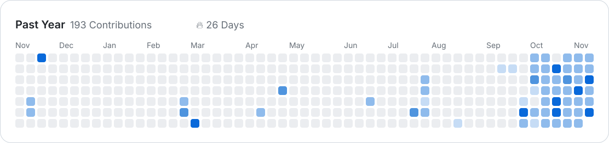

  

---

  <picture>
    <source media="(prefers-color-scheme: dark)" srcset="./assets/contributions-dark.svg" />
    <source media="(prefers-color-scheme: light)" srcset="./assets/contributions-light.svg" />
    
  </picture>

---

<table width="100%">
  <tr>
    <td align="left" valign="middle" width="220">
      
    </td>
    <td align="left" valign="middle">
      🎓&nbsp;Backend&nbsp;Developer  
      💻&nbsp;Laravel&nbsp;Enthusiast  
      😹&nbsp;Lifelong&nbsp;Learner
    </td>
  </tr>
</table>
